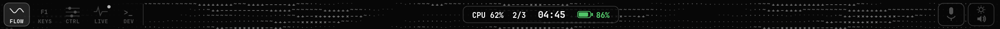

# MacBook Pro Touch Bar for Omarchy

A living Touch Bar for [Omarchy](https://omarchy.org/) on Apple Silicon
MacBook Pros: an animated system field, real function keys, desktop
controls, live agent sessions, a fleet/tmux launcher, and an optional
realtime voice agent — all rendered directly to the Touch Bar
framebuffer with the stock `tiny-dfr` kept one command away as the
rollback.



## Views

Tap the left rail (or hold **Fn** for KEYS). Non-FLOW views return to
FLOW after 8 idle seconds.

| View | What it does |
|---|---|
| **FLOW** | A calm ASCII current. Agent/CPU energy visibly levels it up — density, pace, and spiral strength — while idle stays sparse. Taps ripple the water; status chips show clock, battery, CPU, and agents. |
| **KEYS** | ESC + F1–F12 injected over `/dev/uinput`. Summoned physically by holding **Fn**; releasing Fn returns. |
| **CTRL** | Display / volume / keyboard-backlight / Touch Bar brightness sliders (display never below 8%), plus media keys. FLOW's centre pod carries the same sliders and media cluster. |
| **LIVE** | Agent sessions and windows across this machine and a Tailscale fleet. Cards are two-tap: first tap arms, second opens. Remote cards are real tmux-hosted sessions discovered from the node, never name-matched daemons. |
| **DEV** | Pick a host, pick a harness (`ssh`, `pi`, `claude`, `codex`, `opencode`, `cursor`, `antigravity`, `mcode`, `kimi`, `grok`, `hermes`, a desktop coordinator), confirm, launch. Remote launches live in tmux and resume with the harness's continue flag. |
| **Fleet** | From FLOW's chips: nodes, today's sessions, running sessions, and system detail. |

Notifications only fire for completions and failures (a session must
live at least 90 seconds and be gone for two scans). Tapping the pill
jumps to its session; tapping the ASCII field around it dismisses it.

## Voice (optional)

`pipecat_voice.py` is a live voice agent on
[Pipecat](https://github.com/pipecat-ai/pipecat): the framework owns
turn-taking (Silero VAD, end-of-turn, barge-in), and this repo owns
the machine — PipeWire mic/speaker transports (no inbound exposure;
every connection is outbound), a Gemini brain with function calling,
ElevenLabs TTS for the voice itself, and `voice_tools.py`, the local
tool layer the brain calls: fleet sessions/status, Mnemos memory
recall + remember, shell here or on any fleet node, Second Brain
search, daily brief, window focus, URL open, clipboard, reminders,
media. Quick checks answer by voice; real work follows a spoken
protocol — the agent restates the goal, names the harness, asks
*"Want me to run that?"*, and only on a yes launches `start_work`
(a permissionless coding harness in the background) and reports
once when it finishes. Toggle it from FLOW's pod.

Pipeline: `pw-record` → Silero VAD → Moonshine STT (local, no audio
leaves the box) → Gemini (brain) → ElevenLabs TTS → `pw-cat` to the
speaker. The mic is ducked (not muted) while the agent speaks, so
speaker echo can't self-trigger but a real voice can still barge in.

**Everything voice-shaped is one file: `voice.json`** — the brain
model chain, ElevenLabs voice id + model, the persona prompt
(short, sweet, dry wit; `{{node}}`/`{{time}}`/`{{fleet}}` are filled
in live), the greeting line, and the 17 tool schemas. Keys live only
in `voice-secrets.env` (mode 600, never committed):
`ELEVENLABS_API_KEY` and `GEMINI_API_KEY`.

The brain is a **failover chain** (`brain_models`, first = your
pick). Entries are `provider:model` — `google` (bare names work
too), `anthropic`, `openai`, `openrouter` — and each provider joins
only when its key exists in `voice-secrets.env`
(`GEMINI_API_KEY`, `ANTHROPIC_API_KEY`, `OPENAI_API_KEY`,
`OPENROUTER_API_KEY`), so adding a brain later is a key drop, not a
code change. This matters because metered free tiers are tiny
(Gemini's good Flash models allow ~20 requests/day): a 429/503 or a
stall benches that model and the conversation re-asks on the next,
with patient background retries and one honest spoken status line
instead of silence when the whole chain is down. The greeting is
spoken locally and never waits on a brain. If a turn takes a
moment, the agent says "One sec." rather than leaving dead air.
Every conversation appends one numeric metrics row (turns, words,
agent characters, latency, tool calls) to
`~/.local/state/omarchy-touchbar/voice-metrics.jsonl`.

Test hooks: `OMARCHY_VOICE_MIC` / `OMARCHY_VOICE_SPK` env vars
override the `pw-record`/`pw-cat` PipeWire targets, so the whole
conversation loop can be driven through a virtual mic in tests.

## Install

Requirements: Omarchy on an Apple Silicon MacBook (Touch Bar driven
by tiny-dfr), Python 3 with `cairo`, `foot`, `tmux`, and a Tailscale
mesh if you want fleet features. Voice additionally builds a project
venv (`install.sh` does it) with Pipecat + Moonshine/Silero models.

```bash
git clone https://github.com/brycemurad0/macbook-pro-touchbar-for-omarchy
cd macbook-pro-touchbar-for-omarchy
./install.sh
```

`install.sh` copies the daemon to `~/.config/omarchy/touchbar/`,
installs both systemd user units, adds the `/dev/uinput` udev rule,
masks `tiny-dfr`, and starts the bar. Roll back any time:

```bash
~/.config/omarchy/touchbar/restore.sh
```

tiny-dfr is never uninstalled; masking is reversed by `restore.sh`.

State and diagnostics live in `~/.local/state/omarchy-touchbar/`
(`stats.json` frame timings, `preview.png` periodic render). At 20 fps
the daemon should show `fps == upload_fps`.

## Configuration

Everything machine-specific or preferential is config, never code:

| File (in `~/.config/omarchy/touchbar/`) | Controls |
|---|---|
| `fleet.json` | Display names + ssh aliases per Tailscale node (see `fleet.example.json`) |
| `voice.json` | All voice config: brain failover chain, ElevenLabs voice, persona prompt, greeting, tool schemas (see `voice.example.json`) |
| `voice-secrets.env` | API keys only (`ELEVENLABS_API_KEY`, `GEMINI_API_KEY`, optional `MNEMOS_*`). Mode 600, never committed |
| env `TOUCHBAR_FLOW` | FLOW field preset (default `classic`, the owner-approved field) |
| env `TOUCHBAR_ROTATE` / `TOUCHBAR_FLIP_X` | Panel orientation / touch mirroring |
| Theme files | Colors and font come from the active Omarchy theme |

## Fleet naming (optional)

Display names and ssh aliases that differ from Tailscale DNS labels
live outside the code in `~/.config/omarchy/touchbar/fleet.json`
(see `fleet.example.json`). Remote sessions are discovered with
`ps` ancestry + `tmux list-panes`, so any tmux-hosted harness counts
and no session is ever closed because of its name: only a session
this daemon created is closed when its viewer closes.

## Development

```bash
python3 -m unittest discover -v   # bar + voice regression suites
python3 touchbar.py --snapshot /tmp/tb-snap   # render every view offscreen
```

Key sources: `touchbar.py` (daemon, renderer, session discovery),
`pipecat_voice.py` (Pipecat voice pipeline), `voice_tools.py`
(local tool layer the brain calls), `test_touchbar.py` /
`test_voice_tools.py` (regressions: tap matrix, rail priority,
session ownership, FLOW field shape, pod controls, voice gain/jobs/
metrics/config consistency).

## License

MIT — see [LICENSE](LICENSE).
